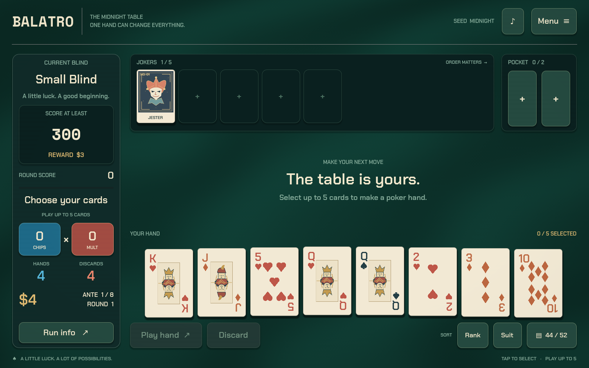
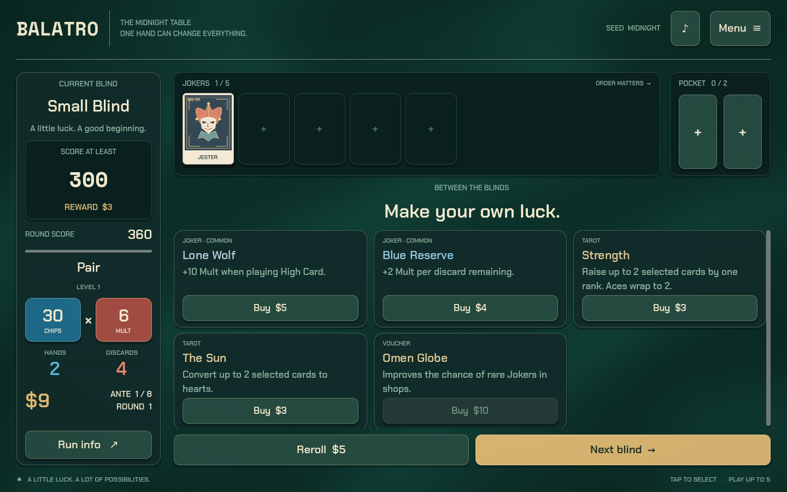
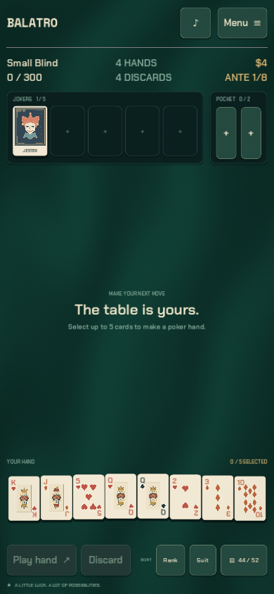
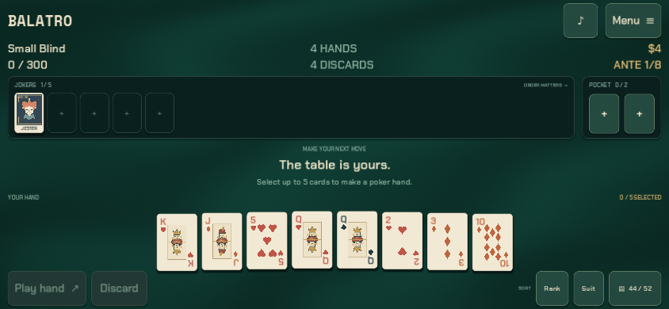

# Balatro · Midnight Table

A playable, mobile-first poker roguelike made with **Godot 4.6.3**. Build poker hands, defeat escalating blinds, then spend your winnings on Jokers and permanent deck upgrades. The project uses original card illustrations, a shaded felt table, optional CRT texture, and synthesized music/effects.

## Screenshots

Actual captures from the playable Godot web export.

**The table** — select poker hands, build Joker combinations, and beat the blind.



**The shop** — spend your winnings on Jokers, consumables, and vouchers.



**Touch layouts** — the interface adapts to portrait and landscape phones.

| Portrait | Landscape |
| :---: | :---: |
|  |  |

## Play

Open `project.godot` in Godot 4.6.3 and press **F6** on `scenes/main.tscn`, or press **F5** to run the project. From a terminal:

```sh
./tools/run.sh
```

Tap or click cards to select up to five. Choose **Play hand** to score or **Discard** to draw replacements. Meet the blind's target before running out of hands. The score is Chips × Mult; Joker effects execute left to right, so placing a +Mult Joker before a ×Mult Joker matters.

- Tap a Joker to read its effect, move it left/right, or sell it.
- Hold a playing card briefly to inspect its enhancement and scoring details.
- After defeating a blind, buy upgrades, reroll offers, or continue to the next blind.
- Select held cards before using a Tarot or Spectral that targets cards. Planets upgrade their named hand immediately.
- **Menu → New run** chooses a seed, deck, stake, and optional challenge. Starting a new run replaces the saved run.
- **Menu → How to play**, **Run info**, and the hand guide explain scoring. Sound, effects, motion, and CRT settings are adjustable.
- Keyboard: **1–8** select cards, **Space** plays, **D** discards, **R** sorts, **Esc** opens/closes the menu.

Runs and preferences save automatically on the current device. A seed reproduces a run when the same choices are made in the same game version.

## Included

| System | Current implementation |
| --- | --- |
| Campaign | 8 antes, 24 blinds, 8 boss rules, win/loss and restart |
| Poker | 12 hand types, including Ace-low straights and enhanced-deck hands |
| Jokers | 37 authored `.tres` Resources, ordered effects, card triggers and scaling |
| Upgrades | 12 Planets, 15 Tarots, 4 Spectrals, 8 Vouchers |
| Cards | 52-card seeded deck, 7 enhancements, 3 editions, Red Seal retriggers |
| Economy | Blind rewards, unused-hand income, interest, rarity-weighted shops, escalating rerolls |
| Run options | 3 decks, 3 stakes, 3 challenges, custom seeds |
| Presentation | Portrait/landscape layouts, touch input, score cascades, inspection dialogs, optional CRT and motion |
| Persistence | Atomic local save/load with preserved RNG state and validated save data |

This is an independent implementation with a focused content set. The commercial game's full 150+ Joker collection, booster-pack selection flow, extensive unlock progression, every boss/stake, and platform storefront integration are outside this build. Physical phone performance, lifecycle behavior, and release distribution still require device testing.

## Test and export

On a Linux cloud machine with Godot 4.6.3 and a JDK, `./tools/setup.sh` prepares verified export templates, Android tools, and imported project assets in one command.

```sh
./tools/test.sh
./tools/install_templates.sh  # one-time official templates, about 1.26 GB
./tools/export.sh web
./tools/serve_web.sh          # http://127.0.0.1:8060
./tools/export.sh linux
```

Validated with Godot 4.6.3: **380 automated checks** across scoring, run state, UI, and card input, plus a complete **24-blind campaign** using legal actions and real targets. The exported Web build is also checked in Chromium at desktop and phone sizes, including shop entry and save persistence after reload.

For an ARM64 Android development APK, install/configure a JDK and Android SDK. This Linux helper prepares the minimal official tools:

```sh
./tools/install_android.sh
./tools/export.sh android
```

Exports appear under `builds/`. The web build uses single-threaded WebAssembly/WebGL 2. Debug APKs use a local development signing key. See [development and platform details](docs/DEVELOPMENT.md) for requirements, exact commands, cloud graphics, and remaining device checks.

## Work on the game

The main scene composes reusable HUD, table, playing-card, Joker, shop, and dialog scenes. Gameplay services are independent from UI presentation. Designers can edit Joker Resources, UI themes, scenes, and shaders in the Godot editor.

See [architecture](docs/ARCHITECTURE.md) for responsibilities, event flow, persistence, and adding content. Automated tests are ordinary GDScript SceneTree runners in `tests/`; they use temporary save directories and do not replace a player's save.

Chakra Petch and Space Mono use the SIL Open Font License; the DejaVu fallback uses its included font license. All license files are in `assets/fonts/`. Balatro is the original game by LocalThunk; this repository supplies its own implementation and assets.
